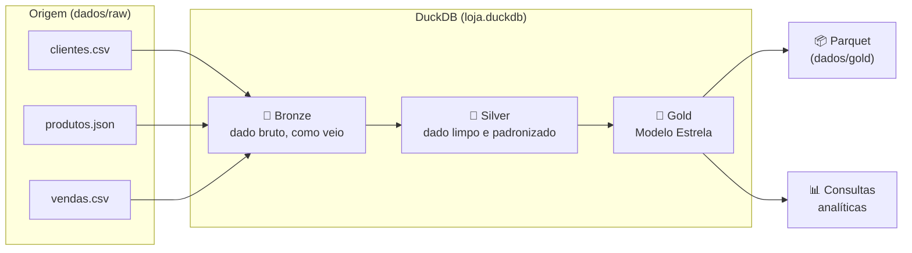
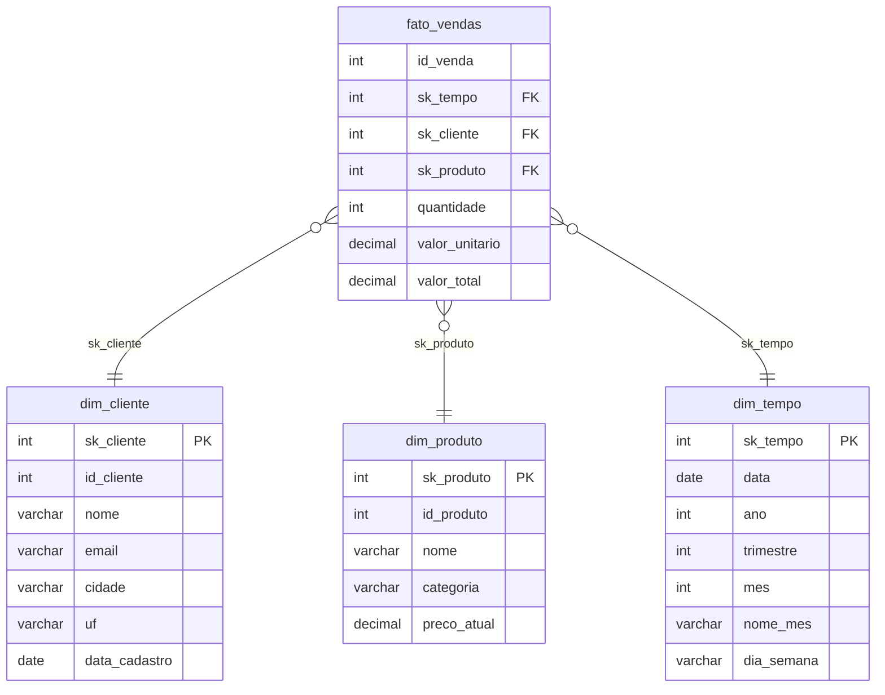

# DuckDB

### Gerenciamento de Banco de Dados - Atividade 11

---

Laboratório prático do seminário **Ecossistema NoSQL, Data Lakes, Data Warehouse e BI**: tema **21 – DuckDB**.

Pipeline de dados completo em **Arquitetura Medalhão (Bronze → Silver → Gold)** com **Modelo Estrela (Star Schema)**, feito 100% em SQL com o DuckDB, simulando as vendas de uma loja de informática de Goiânia.

---

**Integrantes:**

- [Enzo Aquino](https://github.com/EnzoAkino)
- [Gabriel Naoki](https://github.com/GabrielNaokiUT)

---

## Sumário

- [O que é o DuckDB](#o-que-é-o-duckdb)
- [Arquitetura do laboratório](#arquitetura-do-laboratório)
- [Estrutura do repositório](#estrutura-do-repositório)
- [Pré-requisitos](#pré-requisitos)
- [Como executar](#como-executar)
- [Camadas do pipeline](#camadas-do-pipeline)
- [Modelo Estrela (camada Gold)](#modelo-estrela-camada-gold)
- [Demonstração em tempo real](#demonstração-em-tempo-real)
- [Resultados esperados](#resultados-esperados)

---

## O que é o DuckDB

O DuckDB é um banco de dados **analítico (OLAP)** que roda **dentro da aplicação** (*in-process*), sem servidor para instalar ou configurar. É conhecido como o "SQLite da análise de dados".

Neste laboratório ele faz três papéis:

- **Motor de ingestão**: lê CSV, JSON e Parquet direto do disco, sem importar antes.
- **Data Warehouse**: guarda as camadas Bronze, Silver e Gold em um único arquivo (`loja.duckdb`).
- **Motor de Lakehouse**: exporta a camada Gold para **Parquet**, o formato aberto usado em Data Lakes.

---

## Arquitetura do laboratório



| Conceito | Como aparece no laboratório |
|---|---|
| **Ingestão** | `read_csv` e `read_json` lendo os arquivos direto na Bronze |
| **Armazenamento** | Banco colunar `loja.duckdb` + arquivos Parquet em `dados/gold/` |
| **Transformação** | SQL nas camadas Silver (limpeza) e Gold (modelagem dimensional) |
| **Orquestração** | `run_pipeline.bat` / `run_pipeline.sh` executando as etapas em ordem (em produção: Airflow, Dagster ou dbt) |

---

## Estrutura do repositório

```
DuckDB_GBD_Atividade11/
├── dados/
│   ├── raw/                       # Dados de origem (com erros propositais)
│   │   ├── clientes.csv
│   │   ├── produtos.json
│   │   └── vendas.csv
│   └── gold/                      # Arquivos Parquet gerados pelo pipeline
├── docs/
│   ├── DuckDB_Tema21_Slides.pdf              # Slides da apresentação
│   └── DuckDB_Tema21_Relatorio_Tecnico.pdf   # Relatório técnico (conteúdo completo)
├── sql/
│   ├── 01_bronze.sql              # Ingestão dos dados brutos
│   ├── 02_silver.sql              # Limpeza e padronização
│   ├── 03_gold.sql                # Modelo Estrela
│   ├── 04_consultas.sql           # Relatórios analíticos (OLAP)
│   ├── 05_tempo_real.sql          # Demo ao vivo: INSERT, UPDATE e DELETE
│   └── 06_exportar_parquet.sql    # Exportação da Gold para Parquet
├── run_pipeline.bat               # Orquestração (Windows)
├── run_pipeline.sh                # Orquestração (Linux / macOS)
└── README.md
```

Os slides e o relatório técnico do seminário estão na pasta [`docs/`](docs/).

---

## Pré-requisitos

Somente o **DuckDB CLI** (recomendado: versão **2.0.1**). Não precisa de Docker, Python nem servidor.

**Windows**

```cmd
winget install DuckDB.cli
```

**Linux / macOS**

```bash
curl https://install.duckdb.org | sh
```

Depois de instalar, feche e abra o terminal e confira:

```cmd
duckdb --version
```

---

## Como executar

Todos os comandos devem ser executados na **raiz do repositório**.

### 1. Rodar o pipeline completo

**Windows**

```cmd
run_pipeline.bat
```

**Linux / macOS**

```bash
./run_pipeline.sh
```

O pipeline apaga o `loja.duckdb` (se existir), executa Bronze → Silver → Gold → Parquet e para imediatamente se alguma etapa der erro.

### 2. Ver os relatórios analíticos

```cmd
duckdb loja.duckdb -f sql/04_consultas.sql
```

### 3. Rodar a demonstração em tempo real

```cmd
duckdb loja.duckdb -f sql/05_tempo_real.sql
```

### 4. Consultar o Parquet sem abrir o banco

```cmd
duckdb -c "SELECT count(*), sum(valor_total) FROM 'dados/gold/fato_vendas.parquet'"
```

### Rodar uma camada por vez (opcional)

```cmd
duckdb loja.duckdb -f sql/01_bronze.sql
duckdb loja.duckdb -f sql/02_silver.sql
duckdb loja.duckdb -f sql/03_gold.sql
duckdb loja.duckdb -f sql/06_exportar_parquet.sql
```

---

## Camadas do pipeline

### 🥉 Bronze – `sql/01_bronze.sql`

Guarda o dado **exatamente como veio da origem**.

- Lê os arquivos direto com `read_csv` e `read_json`.
- Todas as colunas como texto (`VARCHAR`), para não perder nem alterar nada.
- Adiciona as colunas de rastreio `arquivo_origem` e `carregado_em`.

### 🥈 Silver – `sql/02_silver.sql`

**Limpa e padroniza** os dados da Bronze.

| Problema na origem | Tratamento na Silver |
|---|---|
| Cliente duplicado (João Pereira) | Removido com `QUALIFY row_number()` |
| Espaços sobrando no nome ("  Bruno Lima ") | `trim()` |
| Cidade e UF em minúsculo ("goiania", "go", "df") | Padronizadas ("Goiânia", "GO", "DF") |
| Preço como texto e com vírgula ("249,90") | Convertido para `DECIMAL` (249.90) |
| Produto sem categoria | "Sem categoria" |
| Venda duplicada, sem data, com quantidade 0 ou com cliente inexistente | Separadas em `silver.vendas_rejeitadas` com o **motivo** (não são apagadas) |

### 🥇 Gold – `sql/03_gold.sql`

Transforma os dados limpos em um **Modelo Estrela**, pronto para análise e BI (detalhes na próxima seção).

---

## Modelo Estrela (camada Gold)



- **Tabela fato** (`fato_vendas`): as métricas do negócio (quantidade, valor unitário e valor total).
- **Dimensões**: o contexto de cada venda: **quem** comprou (`dim_cliente`), **o quê** (`dim_produto`) e **quando** (`dim_tempo`).
- **Chaves substitutas (`sk_`)**: chaves próprias do DW, independentes dos IDs do sistema de origem.
- **`dim_tempo`**: calendário de 2026 gerado pelo próprio DuckDB com `generate_series`.

---

## Demonstração em tempo real

O script `sql/05_tempo_real.sql` simula dados novos e correções chegando da origem e mostra o **ANTES x DEPOIS**:

1. **INSERT**: chegam 4 vendas novas da dupla (uma delas com quantidade 0).
2. **UPDATE**: o Headset recebe a categoria que estava faltando.
3. **DELETE**: uma das vendas novas é cancelada.
4. **Reprocessamento** da Silver e da Gold.

| | Vendas | Faturamento | Rejeitadas |
|---|---|---|---|
| **ANTES** | 36 | R$ 41.424,70 | 4 |
| **DEPOIS** | 38 | R$ 45.522,70 | 5 |

O script reconstrói as camadas no início, então pode ser executado quantas vezes for preciso com o mesmo resultado.

---

## Resultados esperados

| Camada | Tabela | Linhas |
|---|---|---|
| Bronze | `bronze.clientes` | 13 |
| Bronze | `bronze.produtos` | 8 |
| Bronze | `bronze.vendas` | 40 |
| Silver | `silver.clientes` | 12 |
| Silver | `silver.produtos` | 8 |
| Silver | `silver.vendas` | 36 |
| Silver | `silver.vendas_rejeitadas` | 4 |
| Gold | `gold.dim_cliente` | 12 |
| Gold | `gold.dim_produto` | 8 |
| Gold | `gold.dim_tempo` | 365 |
| Gold | `gold.fato_vendas` | 36 |

**Faturamento total:** R$ 41.424,70 (jan a jun/2026).

---

## Tecnologias

- [DuckDB](https://duckdb.org) 2.0.1 (CLI)
- SQL
- Parquet
- Git e GitHub

---

<p align="center">
  Desenvolvido para fins acadêmicos | ADS 4º período 2026/2 | Faculdade SENAI FATESG
</p>
